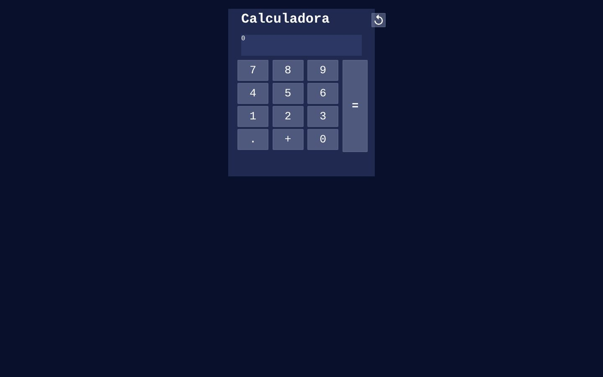
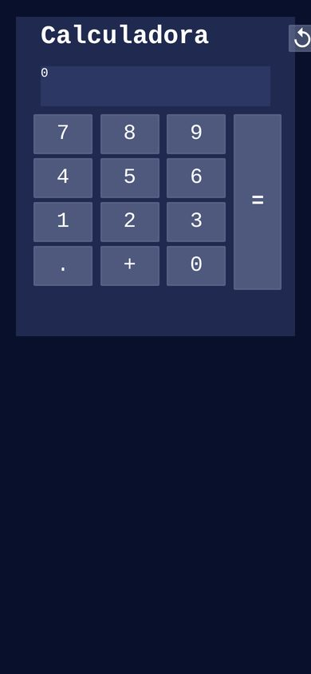

# Calculadora JS

Uma calculadora simples feita com HTML, CSS e JavaScript puro, como projeto de estudo.
A simple calculator built with plain HTML, CSS and JavaScript as a learning project.

[🇧🇷 Português](#-português) · [🇺🇸 English](#-english)

  
  

---

## 🇧🇷 Português

### Sobre o projeto

Uma versão básica de calculadora feita para praticar JavaScript. Por enquanto ela só faz **soma**, e a ideia é adicionar novas operações com o tempo.

Montei a lógica sozinho, sem copiar outro código, como desafio para aplicar o que aprendi no curso de JavaScript básico do professor Gustavo Guanabara (Curso em Vídeo). O layout funciona no computador e no celular.

### Tecnologias

- HTML5
- CSS3
- JavaScript puro

### Como usar

Baixe o repositório e abra o `index.html` no navegador.

### Capturas de tela

**Versão web**

**Versão mobile**

### Próximos passos

- [ ] Subtração, multiplicação e divisão
- [ ] Limpar e apagar o último dígito
- [ ] Suporte ao teclado

---

## 🇺🇸 English

### About

A basic calculator I built to practice JavaScript. For now it only does **addition**; more operations will be added over time.

I wrote the logic on my own, without following existing code, as a challenge to apply what I learned in Gustavo Guanabara's beginner JavaScript course (Curso em Vídeo). The layout works on desktop and mobile.

### Tech stack

- HTML5
- CSS3
- Vanilla JavaScript

### Usage

Download the repository and open `index.html` in your browser.

### Screenshots

See the web and mobile screenshots in the Portuguese section above.

### Roadmap

- [ ] Subtraction, multiplication and division
- [ ] Clear and backspace
- [ ] Keyboard support
